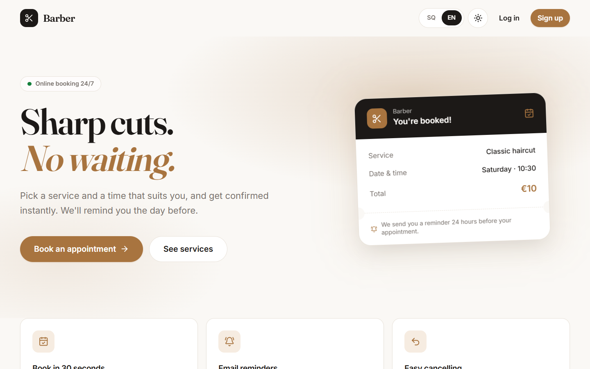
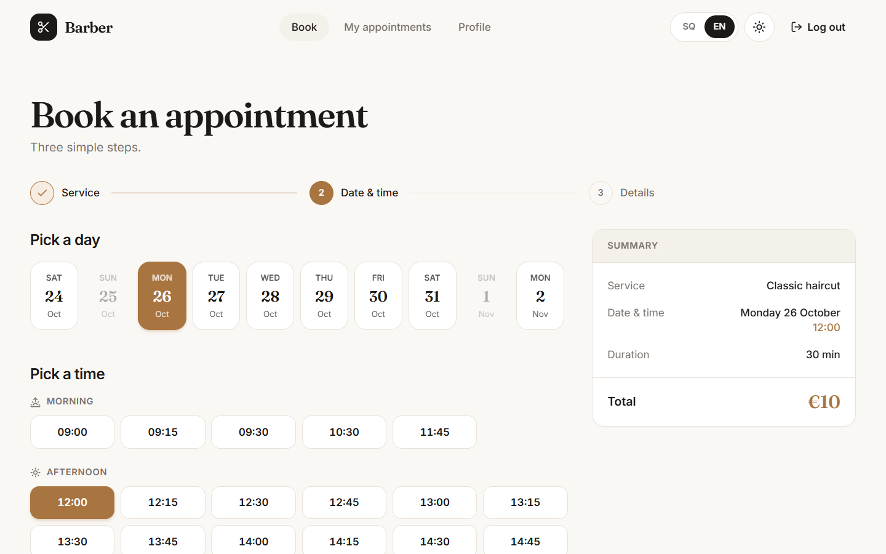
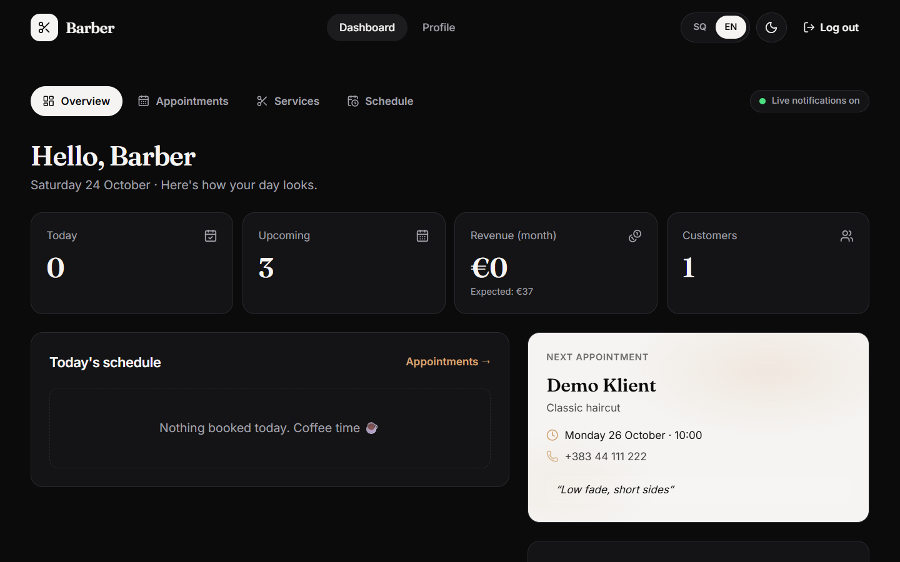
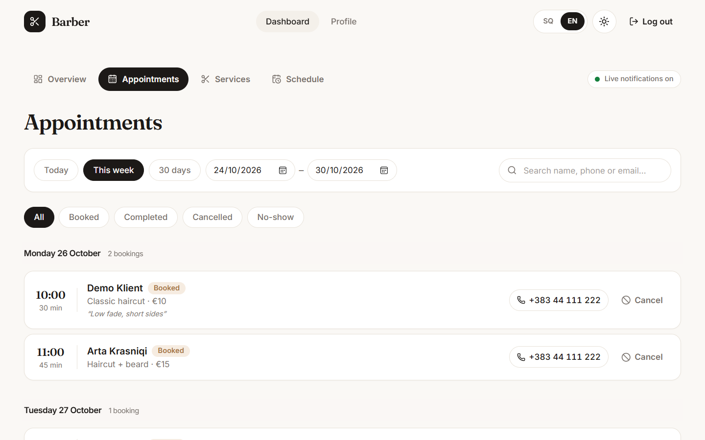
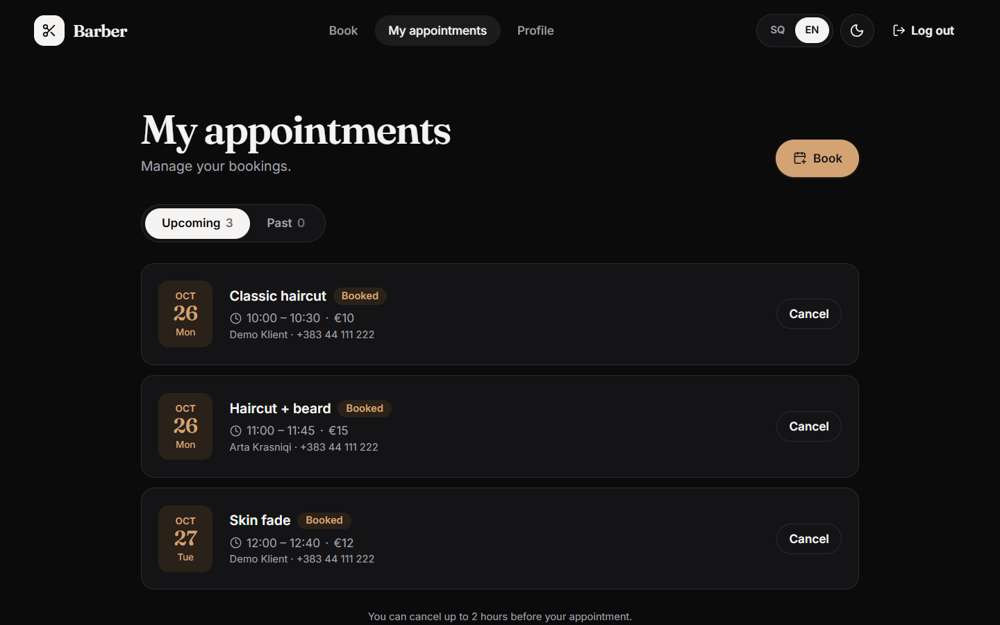
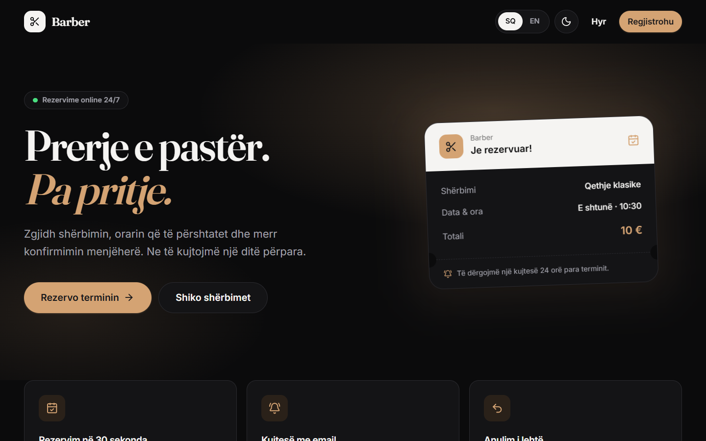
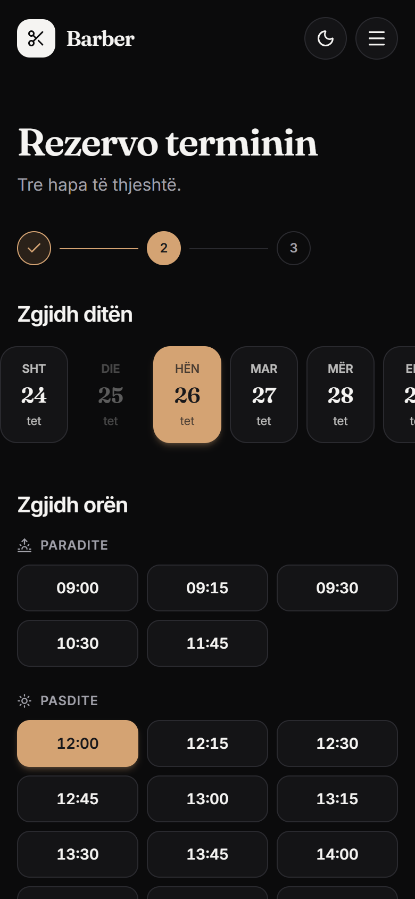
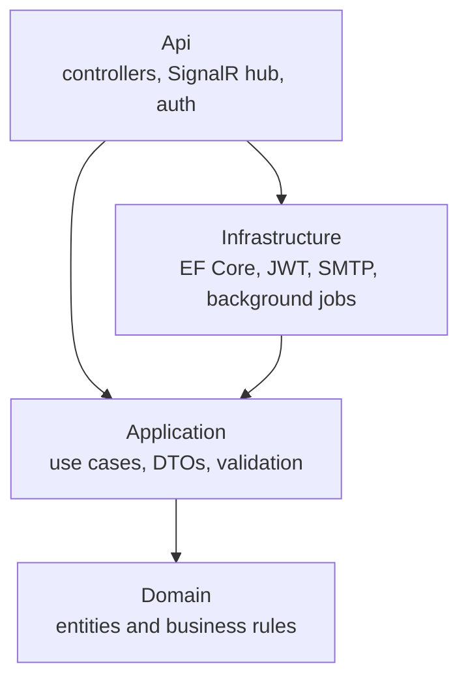

# Barber

A booking app for a single-barber shop. Customers pick a service and a free time slot, the barber gets a live notification, and the customer gets an email reminder the day before.

Built with .NET 10, React, TypeScript and PostgreSQL. The UI is in Albanian and English, with light and dark mode.

**Live demo:** [barber-erion.onrender.com](https://barber-erion.onrender.com)

Hosted on Render (website and API) with a Neon PostgreSQL database, all on free tiers, so the first request after a period of inactivity can take up to a minute while the API wakes up.




## Why I built this

Most small barbershops around me still take appointments over phone calls and Instagram messages. Bookings get lost, two people show up for the same slot, and customers forget they booked at all.

I wanted a portfolio project that solves that real problem end to end, rather than another to-do app. It was also a good way to work on things I hadn't done much before: real-time updates, background jobs, time zones and handling concurrency properly.

## What it does

**Customers** can:
- register, log in and book in three steps: service, date and time, contact details
- see only slots that are actually free, based on opening hours, days off, existing bookings and how long the service takes
- view and cancel their appointments (up to 2 hours before)
- receive a confirmation email and a reminder 24 hours before, in their chosen language

**The barber** can:
- see new bookings and cancellations appear live on the dashboard, with a sound
- track today's schedule, the next appointment, the coming week and monthly revenue
- filter and search appointments, mark them as completed or no-show, or cancel them (the customer is emailed)
- manage services and prices, weekly opening hours and days off

The barber account can't book appointments. That's enforced by the API, not just hidden in the UI.

## Screenshots

| Booking | Admin dashboard |
|---|---|
|  |  |

| Appointments (admin) | My appointments |
|---|---|
|  |  |

| Dark mode, Albanian | Mobile |
|---|---|
|  |  |

## Tech stack

**Backend:** .NET 10, ASP.NET Core Web API, Entity Framework Core, SignalR, FluentValidation, MailKit, xUnit

**Frontend:** React 19, TypeScript, Vite, Tailwind CSS 4, TanStack Query, React Router, React Hook Form + Zod, i18next

**Database:** PostgreSQL 17

**Infrastructure:** Docker, Docker Compose, nginx

## Architecture

The backend follows Clean Architecture, split into four projects:



- **Domain** has the entities and their rules, for example an appointment can't be marked completed before it starts.
- **Application** contains the use cases (booking, availability, auth, scheduling) and defines interfaces for what it needs from the outside, like `IEmailSender` or `IBarberNotifier`.
- **Infrastructure** implements those interfaces with PostgreSQL, SMTP and so on.
- **Api** is just the entry point: HTTP, WebSockets and auth.

Because the business logic only depends on interfaces, I can swap the email provider or test the logic without a database.

I didn't use MediatR or a repository layer. Plain services per feature, with EF Core's `DbContext` behind an interface, were enough for a project this size and kept the code easy to follow.

## Interesting problems

### Preventing double bookings

My first version only checked availability in code before saving. That works until two people book the same slot at the same moment: both checks pass and both bookings get saved.

The fix was to let PostgreSQL enforce it with an exclusion constraint on the time range of every booked appointment:

```sql
EXCLUDE USING gist (tstzrange(start_time, end_time, '[)') WITH &&)
WHERE (status = 'Booked')
```

Now the database rejects any overlap, no matter how many requests arrive at once. The API turns that rejection into a `slot_unavailable` error, and the frontend shows "That time was just taken."

### Time zones

Appointments are stored in UTC, but opening hours like "09:00 to 19:00" only make sense in the shop's local time. All conversions go through one class, `ShopClock`, which uses the shop's configured time zone (`Europe/Tirane`). That way daylight-saving changes don't shift anyone's appointment by an hour.

### Notifications shouldn't break bookings

If the email server is slow or down, the booking should still succeed. Emails go into an in-memory queue (`Channel<T>`), and a background worker sends them with retries. A second background worker checks every minute for appointments that need a reminder.

For the barber's live notifications I used SignalR. When a booking is saved, the API pushes it to the admin dashboard, which shows a toast and refreshes its data.

### Translating errors

The UI is in two languages, so the API can't just return English error messages. Every error has a stable code, like `slot_unavailable` or `cancellation_too_late`, in an RFC 7807 problem response, and the frontend translates the code.

## Running it locally

You need the .NET 10 SDK, Node.js 22+ and Docker.

Start the database, the test mail inbox and the database viewer:

```bash
docker compose -f docker-compose.dev.yml up -d
```

Start the API on http://localhost:5036:

```bash
cd backend
dotnet run --project src/Barbershop.Api
```

Start the website on http://localhost:5173:

```bash
cd frontend
npm install
npm run dev
```

The API runs the migrations and seeds a barber account, sample services and opening hours on first start. Log in as the barber with `admin@barbershop.local` / `Admin12345`; customers can register on the site.

| Tool | URL |
|---|---|
| API docs (Scalar) | http://localhost:5036/scalar/v1 |
| Test email inbox (Mailpit) | http://localhost:8025 |
| Database viewer (Adminer) | http://localhost:8081 |

To run the whole stack in containers instead, copy `.env.example` to `.env`, fill it in and run `docker compose up --build`. The site is then at http://localhost:8080.

Shop rules such as booking window, cancellation cutoff and reminder timing are in `backend/src/Barbershop.Api/appsettings.json` under `Shop`, and can be overridden with environment variables (`Shop__BookingWindowDays=60`).

## Tests

```bash
cd backend && dotnet test
```

The unit tests cover the slot calculation and the appointment state rules. The slot calculation is a pure function (`SlotCalculator`), so it can be tested without a database.

## What I'd do next

- integration tests for the API against a real PostgreSQL database
- a GitHub Actions pipeline that runs the build and tests on every push
- password reset and email verification
- let the barber add bookings for walk-in and phone customers
- rescheduling without having to cancel first

## Author

Erion Janova · [GitHub](https://github.com/erionjanova) · [LinkedIn](https://www.linkedin.com/in/erion-janova-60bb42340)
